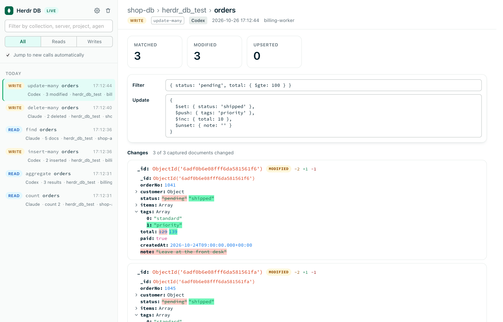
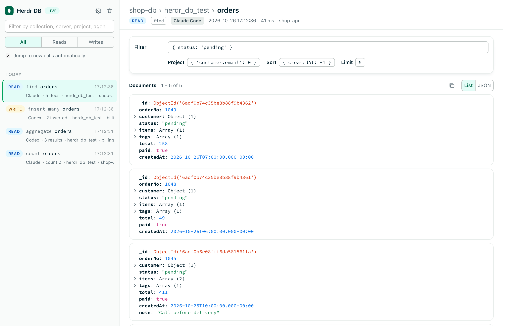
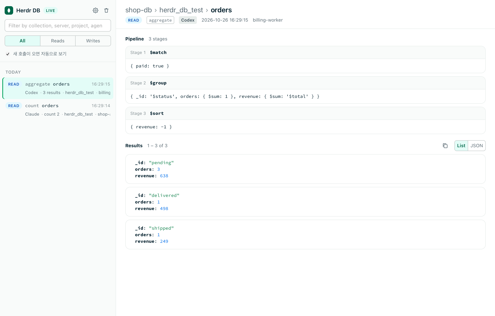
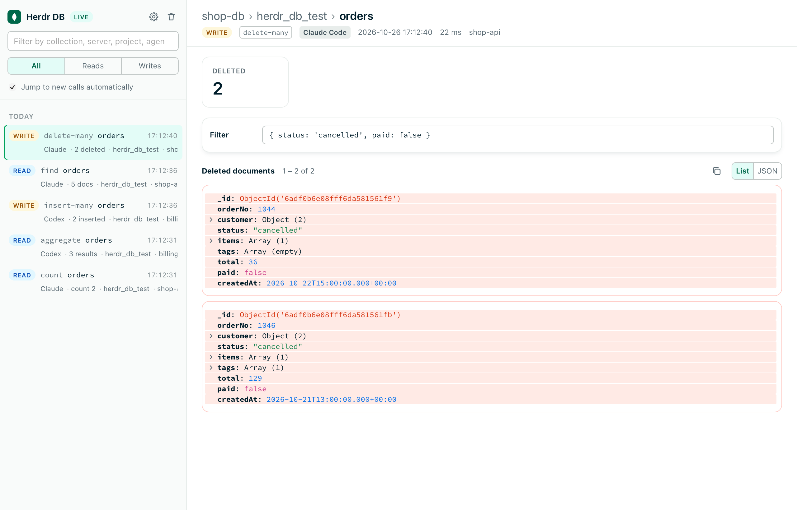
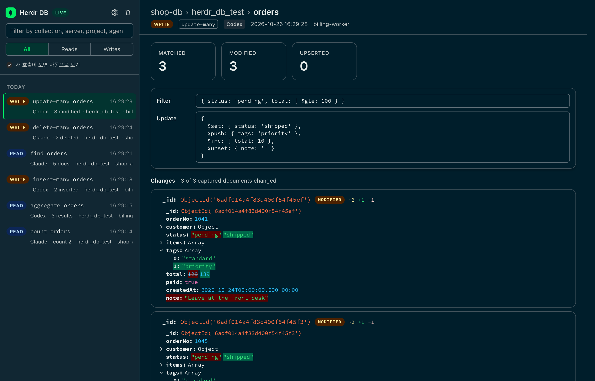

<div align="center">

# Herdr DB

**See exactly what your coding agent read from — and wrote to — your MongoDB.**

A [herdr](https://herdr.dev) plugin that turns every MongoDB MCP call made by **Claude Code** or **Codex**
into a Compass-style view: the query, the documents that came back, and a before/after diff of every write.

[](LICENSE)


[English](README.md) · [한국어](README.ko.md)



</div>

## Why

Agents are great at poking around a database through the
[MongoDB MCP server](https://github.com/mongodb-js/mongodb-mcp-server) — and terrible at telling you
what they actually did. In the transcript you get a wall of JSON, and for `update-many` or
`delete-many` you get nothing but a count. *Which* documents changed? What did they look like before?

Herdr DB answers that without slowing the agent down. Every MongoDB tool call opens in a small native
window next to your terminal, formatted the way MongoDB Compass would show it.

## Features

- **Reads, the Compass way** — `find`, `aggregate`, `count` and `export` show the Filter / Project /
  Sort / Limit bar or the pipeline stage by stage, followed by the returned documents with BSON types
  (`ObjectId`, `Date`, `Decimal128`, `Long` …), collapsible fields and a List / JSON toggle.
- **Real diffs for writes** — `update-many` is shown as a per-document diff (changed, added, removed
  fields; array elements aligned). `delete-many` lists the documents that were removed, `insert-many`
  the ones that were added.
- **Claude Code and Codex** — one viewer for both agents. Each call is tagged with the agent, the
  project it ran in and, inside herdr, the workspace and pane.
- **Failed calls too** — errors from the MCP server are recorded with their message.
- **Never in the way** — the hooks have no output and always exit 0, so they can't block, slow down
  or change a tool call. The window comes forward without stealing keyboard focus.
- **Native or browser** — a tiny menu-bar app (no Dock icon) or a tab on a local port, switchable
  from the settings screen at any time.
- **English and Korean** — follows the system language, or pick one in settings.
- **Light and dark** — follows the system appearance.

<table>
  <tr>
    <td></td>
    <td></td>
  </tr>
  <tr>
    <td></td>
    <td></td>
  </tr>
</table>

## Requirements

| | |
| --- | --- |
| herdr | 0.7.5 or newer |
| Node.js | 22 or newer, on `PATH` when you install |
| Agent | Claude Code and/or Codex, with [`mongodb-mcp-server`](https://github.com/mongodb-js/mongodb-mcp-server) configured as an MCP server |
| Native window | macOS with the Xcode Command Line Tools (`swiftc`). Without them — or on Linux — the viewer opens in your browser |

## Install

```bash
herdr plugin install speardragon/herdr-db
```

The install builds the viewer, builds the macOS app and registers hooks for every agent it finds on
this machine (`~/.claude` → Claude Code, `~/.codex` → Codex). Existing settings files are backed up
first, and only herdr-db's own entries are touched.

Then finish the setup for each agent:

- **Claude Code** — restart running sessions.
- **Codex** — open `/hooks` in Codex once and trust the herdr-db hooks, then restart sessions.
  If the hook command changes later (a new Node.js path or plugin location), Codex asks again.

That's it. The next time an agent calls a MongoDB tool, the window opens.

<details>
<summary>Installing from a local checkout</summary>

`herdr plugin link` does not run build steps, so build and register the hooks yourself:

```bash
git clone https://github.com/speardragon/herdr-db && cd herdr-db
npm ci && npm --prefix ui ci && npm run build
herdr plugin link "$PWD"
node bin/install-hooks.mjs            # or --agent=claude / --agent=codex
```

</details>

## Usage

You don't have to do anything — keep working with your agent. Herdr DB records every MongoDB call and
brings the viewer forward when one arrives.

- The sidebar lists calls newest first. Filter by collection, server, project or agent, or show only
  reads or writes.
- Turn off auto-follow (the checkbox under the filter) to stay on the call you're reading while new ones come in.
- The 🍃 menu-bar icon reopens the window, opens settings, or opens the viewer in the browser.
  Closing the window doesn't stop recording.

### herdr actions

| Action | What it does |
| --- | --- |
| `ray.herdr-db.open` | Open the viewer |
| `ray.herdr-db.settings` | Open the settings screen |
| `ray.herdr-db.install-hooks` | Install or repair the hooks (e.g. after a Node.js upgrade) |
| `ray.herdr-db.uninstall-hooks` | Remove herdr-db's hooks and nothing else |

Bind one to a key in `~/.config/herdr/config.toml`:

```toml
[[keys.command]]
key = "prefix+m"
type = "plugin_action"
command = "ray.herdr-db.open"
description = "MongoDB calls"
```

## How it works

```
Claude Code ─┐  PreToolUse / PostToolUse hooks            ~/.herdr-db/events/*.json (0600)
             ├──────────────────────────────▶ bin/hook.mjs ─────────────┐
Codex ───────┘  (mcp__<server>__find, …)                                 ▼
                                                    bin/server.mjs on 127.0.0.1:47917 (SSE)
                                                                         │
                                              Herdr DB.app (menu bar) or a browser tab
```

herdr's own plugin events don't see MCP tool calls, so capturing is done by **agent hooks**. The herdr
plugin installs and repairs those hooks and opens the viewer.

- **Reads cost nothing.** The hook only reads what the agent already received (`tool_input` and
  `tool_response`). It never re-queries the database for a read.
- **Writes are snapshotted.** `update-many` and `delete-many` only return counts, so just before the
  call the hook reads up to `snapshotLimit` documents matching the filter, then reads the same `_id`s
  again afterwards and diffs the two.
- **Connection strings are looked up, never stored.** For snapshots the hook finds the MCP server's
  connection string the same way your agent does, every time it needs one:
  - Claude Code: `~/.claude.json` (project and user scope) and `.mcp.json`
  - Codex: `.codex/config.toml` in the project, then `~/.codex/config.toml`

  If yours lives somewhere else, set `HERDR_DB_URI_<SERVER_NAME>` in the agent's environment
  (for example `HERDR_DB_URI_SHOP_DB` for a server named `shop-db`). If none is found, the write is
  still recorded — just without a diff.

### Captured tools

| Kind | Tools |
| --- | --- |
| Read | `find`, `aggregate`, `aggregate-db`, `count`, `export` |
| Write | `insert-many`, `update-many`, `delete-many`, and `aggregate` with `$out` / `$merge` |
| Admin | `create-index`, `drop-index`, `create-collection`, `drop-collection`, `drop-database`, `rename-collection` |
| Metadata | `list-databases`, `list-collections`, `collection-schema`, `collection-indexes`, `collection-storage-size`, `db-stats`, `explain` |

Codex reports these with `_` instead of `-` (`update_many`); both are handled.

## Settings

Open settings from the ⚙ button in the sidebar, the menu-bar icon or the `ray.herdr-db.settings` action.
Changes are saved to `~/.herdr-db/config.json` and apply immediately. The same screen shows the hook
status for each agent, connected viewers and how many calls are stored.

| Setting | Default | |
| --- | --- | --- |
| `viewer` | `app` | `app` (native window) or `browser` (a tab on the local port) |
| `autoOpen` | `always` | `always`, `writes` (only bring the viewer up for writes) or `never` (record silently) |
| `locale` | `auto` | `auto` (system language), `en` or `ko`. The menu-bar menu follows it too |
| `snapshotLimit` | `50` | Documents read before `update-many` / `delete-many` |
| `maxEvents` | `500` | Older calls are deleted beyond this… |
| `maxAgeDays` | `14` | …or after this many days |
| `port` | `47917` | File only. Quit the server and the app after changing it |

Run `node bin/status.mjs` in the plugin directory for the same status in the terminal.

## Privacy and security

Captured calls contain real data from your database, so Herdr DB keeps them local and short-lived:

- Everything stays on your machine. `~/.herdr-db` is created `0700` and every event file `0600`.
  Old calls are pruned by `maxEvents` / `maxAgeDays`, and the trash button clears them all.
- The viewer server listens on `127.0.0.1` only and rejects requests with a foreign `Host` header.
  The settings API only accepts JSON, which browsers can't send cross-origin without a preflight.
- Connection strings are resolved in memory when a snapshot is taken and never written anywhere.
- Snapshots are plain reads with a short timeout. Herdr DB never writes to your database.

## Uninstall

Remove the hooks **before** uninstalling the plugin — herdr has no uninstall step, so hooks left
behind would keep pointing at a deleted script:

```bash
herdr plugin action invoke uninstall-hooks --plugin ray.herdr-db
herdr plugin uninstall ray.herdr-db
rm -rf ~/.herdr-db        # captured calls and settings
```

## Troubleshooting

<details>
<summary>The window never opens</summary>

1. Run `node bin/status.mjs` in the plugin directory and check the hook line for your agent.
2. Restart the agent session — hooks are read at startup.
3. Codex: open `/hooks` and make sure the herdr-db hooks are trusted.
4. Check `autoOpen` isn't `never`, and look at `~/.herdr-db/hook.log`.

</details>

<details>
<summary>Writes show "no snapshot"</summary>

The connection string for that MCP server wasn't found (see [How it works](#how-it-works)), or the
agent used a connection opened at runtime with the `connect` tool, which hooks can't see. Set
`HERDR_DB_URI_<SERVER_NAME>` to fix the first case.

</details>

<details>
<summary>The hooks stopped working after a Node.js upgrade</summary>

The hooks pin the `node` binary that installed them. If a version manager removed it, run the
`ray.herdr-db.install-hooks` action again (and re-trust the hooks in Codex).

</details>

## Development

```bash
npm ci && npm --prefix ui ci
npm test                       # hooks, server, store, settings (node:test)
npm --prefix ui test           # BSON formatting, diff, mongosh printer (vitest)
npm --prefix ui run dev        # UI dev server, proxies /api to 127.0.0.1:47917
npm run build                  # UI bundle + macOS app

# Snapshot integration test against a throwaway local MongoDB (uses the herdr_db_test database)
HERDR_DB_TEST_URI='mongodb://localhost:27017/?directConnection=true' npm test
```

The project is plain Node.js ESM (`src/`, `bin/`), a React + Vite viewer (`ui/`) and a ~190-line Swift
wrapper around `WKWebView` (`mac/`).

## Acknowledgements

The viewer's look follows [MongoDB Compass](https://github.com/mongodb-js/compass) and the
[LeafyGreen](https://github.com/mongodb/leafygreen-ui) palette. Compass is SSPL-licensed, so no code was
copied; the views were written from scratch. Herdr DB is not affiliated with or endorsed by MongoDB, Inc.

The Claude Code and OpenAI logos only mark which agent made a call. Claude and Claude Code are trademarks
of Anthropic, PBC; OpenAI, ChatGPT and Codex are trademarks of OpenAI. Herdr DB is not affiliated with or
endorsed by either. The marks come unmodified from [Simple Icons](https://simpleicons.org) (CC0) and
[Lobe Icons](https://github.com/lobehub/lobe-icons) (MIT).

## License

[MIT](LICENSE) © speardragon
